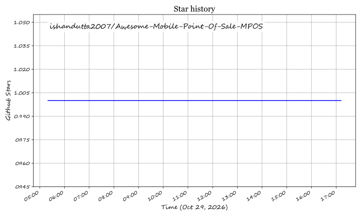

  

# Awesome Mobile Point of Sale (mPOS) 💳📱

  
  
  
  
  
  

> 🌟 A curated directory of premier **Mobile Point of Sale (mPOS)** SaaS platforms, handheld Android smart payment terminals, and open-source mPOS applications.

**Mobile Point of Sale (mPOS)** transforms smartphones, tablets, and dedicated handheld terminals into secure, PCI-compliant payment stations. By untethering the checkout counter, mPOS empowers retail merchants 🛍️, restaurants 🍽️, field technicians 🔧, delivery drivers 🚚, and pop-up vendors 🎪 to process chip & PIN (EMV), contactless NFC (Apple Pay, Google Pay) 📲, QR codes 🏁, and tap-to-pay anywhere with cellular or Wi-Fi connectivity.

---

## 📊 Sector Overview & Market Dynamics 📈

The global **Mobile Point of Sale (mPOS)** market is valued at approximately **$41.2 billion in 2025** and is projected to surpass **$105 billion by 2032**, expanding at a robust **CAGR of ~14.5%** 🚀. Growth is propelled by widespread contactless adoption, Android-based smart terminal proliferation, SoftPOS / Tap-to-Pay on standard smartphones, and the omnichannel convergence of in-person checkout with cloud ecommerce 🌐.

Market consolidation and competitive dynamics:
- 🏛️ **Moderately Concentrated in Core Payment Acquiring:** The hardware manufacturing and acquiring rails are dominated by scaled incumbents (**Block/Square**, **Fiserv/Clover**, **Shopify**, **Toast**, and hardware OEMs like **PAX Technology**, **Ingenico**, and **Verifone**) due to extreme regulatory moats, PCI-PTS security certifications, and merchant acquiring relationships.
- 🧩 **Highly Fragmented in Verticalized Apps & Storefront Software:** Downstream applications remain fragmented across specialized verticals (restaurant tableside ordering, retail queue-busting, salon booking, field service, pop-up events) and developer-first custom Android apps.
- 🔓 **Open-Source Landscape:** Open-source tooling flourishes in frontend mobile cash registers (Flutter/React Native) and decentralized/crypto rails (Bitcoin Lightning, Cashu, Monero) ⚡, while traditional card-present EMV acquiring relies on certified vendor hardware and commercial payment SDKs.

---

## 📑 Table of Contents 🧭

- [📊 Sector Overview & Market Dynamics 📈](#-sector-overview--market-dynamics-)
- [💼 Leading SaaS Platforms & Smart Terminal Ecosystems 💳](#-leading-saas-platforms--smart-terminal-ecosystems-)
- [🛠️ Open-Source GitHub Projects 💻](#️-open-source-github-projects-)
  - [📱 Mobile POS Applications (Flutter & Cross-Platform)](#-mobile-pos-applications-flutter--cross-platform)
  - [⚡ Decentralized & Crypto-Native mPOS](#-decentralized--crypto-native-mpos)
  - [🌐 Web-Based & PWA Mobile POS](#-web-based--pwa-mobile-pos)
  - [🧰 Terminal Developer SDKs & Production Kits](#-terminal-developer-sdks--production-kits)
- [🔍 Comparison Matrix: SaaS vs. Self-Hosted mPOS ⚖️](#-comparison-matrix-saas-vs-self-hosted-mpos-️)
- [🤝 How to Contribute ✍️](#-how-to-contribute-️)
- [💖 Support & Community ☕](#-support--community-)
- [📈 Star History ⭐](#-star-history)
- [⚖️ Security & Compliance Disclaimer 🛡️](#️-security--compliance-disclaimer-️)

---

## 💼 Leading SaaS Platforms & Smart Terminal Ecosystems 💳

The table below lists the prominent commercial mPOS providers, sorted in descending order by **Company Size (Revenue / Market Capitalization / Valuation)** 🏆:

| Platform 🚀 | Category / Form Factor 📦 | Starting Pricing (Specific Tier) 💵 | Free Tier / Free Trial Limits 🎁 | Company Size (Revenue / Valuation) 🏢 | Key Features ⚙️ |
| :--- | :--- | :--- | :--- | :--- | :--- |
| **[Shopify POS Go](https://www.shopify.com/pos)** | Integrated Handheld Smart Terminal & Barcode Scanner | **$5/mo** (Starter plan) or **$39/mo** (Basic Shopify) + 2.4% to 2.9% + 30¢ per transaction; Hardware: **$299** one-time | **3-day free trial** with full platform access, followed by **$1/month for the first month** promotional limit | **$120B+ Market Cap** (~$8.9B annual revenue) | Handheld POS with integrated barcode scanner, receipt printing, inventory tracking, and Shopify unified multi-location synchronization. |
| **[Square Terminal (Block)](https://squareup.com/us/en/hardware/terminal)** | All-in-One Portable Contactless Terminal | **$0/mo** platform fee + **2.6% + 10¢** per in-person swipe/dip/tap; Hardware: **$299** one-time or **$27/mo** over 12 months | **Free forever plan** with $0 software monthly fee, unlimited transactions (pay-as-you-go processing fee only), 1 active POS location, and standard reporting | **$45B+ Market Cap** (~$22.8B annual gross revenue) | Built-in thermal printer, 24-hour offline transaction mode, EMV chip, magstripe, and Apple Pay/Google Pay support. |
| **[Clover Flex (Fiserv)](https://www.clover.com/pricing/flex)** | Portable Handheld Smart Terminal | **$14.95/mo** (Payments Plus SaaS) + **2.3% + 10¢**; Hardware: **$40/mo for 36 months** or **$749** one-time purchase | **30-day money-back trial guarantee** for hardware and software plans; no permanent free software tier | **$80B+ Market Cap** (Fiserv parent; ~$19.5B annual revenue) | Tableside ordering, barcode scanner, integrated thermal receipt printer, cellular 4G LTE/Wi-Fi, and Clover App Market extensions. |
| **[Toast Go (Toast Inc.)](https://pos.toasttab.com/)** | Rugged Restaurant Handheld POS | **$0/mo** Quick Start plan (with higher processing rate of 2.99% + 15¢) or **$69/mo** Standard plan; Toast Go 2 hardware: **$627** one-time or **$0 upfront financing** | **Free forever tier** via the "Quick Start" plan (includes cloud POS software, 1 POS terminal license, real-time kitchen integration, and basic reporting with pay-as-you-go processing) | **$18B+ Market Cap** (~$4.7B annual revenue) | Splash-resistant, drop-tested handheld terminal with tableside ordering, menu item 86ing, tip prompts, and direct Kitchen Display System (KDS) routing. |
| **[Ingenico Move 5000](https://www.ingenico.com/)** | Certified Portable EMV / NFC Smart Terminal | **€19/mo to €29/mo** terminal gateway leasing + ISO/acquirer processing fees (varies by merchant processor; hardware capex ~**€350–€450**) | **No free tier**; enterprise testing evaluation units provided during processor qualification and onboarding agreements | **~$4.5B Valuation** (Acquired by Apollo Funds; generates ~$2.5B+ annual revenue) | Telium TETRA / Android OS, 4G LTE, fallback Wi-Fi/Bluetooth, PCI-PTS 5.x/6.x certification, and high-speed receipt printer. |
| **[Verifone Carbon Mobile](https://www.verifone.com/)** | Dual-Screen & Handheld Android Smart Terminals | **$25/mo to $45/mo** SaaS device management + acquirer processing margin; Hardware capex ~**$400–$650** | **No free tier**; certified software partner sandbox and SDK developer testing accounts available with zero hardware subsidy | **~$3.4B Valuation** (Acquired by Francisco Partners; ~$2B+ revenue base) | Dual merchant/customer displays, Android-based Commerce OS, EMV Level 1/2/3 compliance, and remote terminal management (VHQ). |
| **[PAX Technology (A920 Pro / A60)](https://www.pax.us/)** | Enterprise Android Mobile POS Terminal | **$15/mo to $25/mo** device management through MAXSTORE + acquirer processing rate; Hardware: **$300–$450** | **Free developer account** on PAX MAXSTORE sandbox with test terminal simulator tools; no free physical device tier | **~$1.5B Market Cap** (HKEX: 0327; ~$1.1B annual revenue) | PayDroid Android architecture, integrated 2-inch thermal printer, front/rear cameras for 1D/2D scanning, and global PCI PTS 6.x approvals. |
| **[Newland N910](https://www.newland-id.com/)** | Wireless Android Smart Payment Terminal | **$12/mo to $20/mo** MDM licensing + acquirer clearing fees; Hardware: **$280–$390** | **Free SDK access and terminal emulator** for certified ISV developers upon partner registration; physical terminals require merchant account | **~$1.2B Market Cap** (Newland Digital Technology; ~$1.0B revenue) | Android 10/11 Go edition, 4G, high-capacity 5200mAh battery, capacitive 5.5" IPS touch screen, and integrated high-speed thermal printer. |
| **[Castles Technology (Saturn 1000)](https://www.castlestech.com/)** | Rugged Android Mobile Payment Terminal | **$12/mo to $22/mo** gateway & MDM + processor interchange; Hardware: **$290–$420** | **Free CastlePay test sandbox** for registered software vendors with API rate limit of 100 test requests/day; hardware is enterprise purchase only | **~$600M Valuation** (Private / Leading global terminal manufacturer) | Android OS with secure Castles payment architecture, barcode scanner, NFC contactless, and long battery life for field sales. |
| **[Poynt (GoDaddy Smart Terminal)](https://poynt.com/)** | Dual-Screen Smart Wireless POS | **$0/mo** software plan + **2.3% + 30¢** in-person processing; Hardware: **$249–$499** one-time | **Free forever plan** with $0 monthly platform subscription fee, unlimited inventory items, and basic reporting when utilizing GoDaddy Payments | **$320M Acquisition** (Acquired by GoDaddy; GoDaddy parent Market Cap ~$28B) | Dual screens (merchant facing and customer facing), wireless charging dock, built-in thermal printer, and third-party Android app marketplace. |

---

## 🛠️ Open-Source GitHub Projects 💻

Open-source mobile point-of-sale implementations provide transparent foundations for frontend cash registers 📟, offline inventory systems 📦, thermal receipt printing 🖨️, and cryptocurrency rails 🪙.

Repos are sorted in descending order by **GitHub_Stars_Count** ⭐:

### 📱 Mobile POS Applications (Flutter & Cross-Platform)

- **[evan361425 / flutter-pos-system](https://github.com/evan361425/flutter-pos-system)**   
  *Open-source Flutter POS system tailored for small restaurants, cafes, and retail shops.* ☕  
  Features table layout planning, order management, cash register drawer reconciliation, offline-first SQLite database, analytics charts, and Bluetooth ESC/POS receipt printing. Privacy-focused architecture with zero forced telemetry.

- **[tcd93 / flutter-pos](https://github.com/tcd93/flutter-pos)**   
  *Cross-platform Flutter mobile POS application engineered specifically for Sunmi Android POS handheld devices.* 📟  
  Demonstrates direct integration with Sunmi onboard thermal printer hardware SDKs, multi-currency support, order splitting, barcode scanning, and fast transaction dispatch.

- **[elrizwiraswara / flutter_pos](https://github.com/elrizwiraswara/flutter_pos)**   
  *Clean Architecture and offline-first mobile POS built with Flutter, SQLite, and Firebase Firestore.* 🧱  
  Features automatic two-way catalog synchronization, transaction queueing during network dropouts, and multi-format thermal receipt printing (58mm, 72mm, and 80mm via Bluetooth/USB/Network).

- **[wilsonanyonga / flutter_pos](https://github.com/wilsonanyonga/flutter_pos)**   
  *Lightweight Flutter-based retail point-of-sale register application.* 🛍️  
  Provides catalog itemization, tax computation, stock inventory counting, daily ledger balances, and responsive layouts suitable for both compact Android smartphones and tablets.

- **[The-POS / The-POS-Flutter](https://github.com/The-POS/The-POS-Flutter)**   
  *Modular enterprise mobile POS frontend written in Flutter.* 🏢  
  Implements layered state management, multi-cashier login with role-based access control (RBAC), multi-store location switching, receipt generation, and payment gateway abstraction.

- **[torchice / Dypos](https://github.com/torchice/Dypos)**   
  *Flutter + Firebase point of sale mobile application.* 🔥  
  Includes real-time cloud data storage, customer profile tracking, sales analytics reporting with customizable period views, and rapid product search.

- **[Derida23 / PIXOS-POS-ReactNative](https://github.com/Derida23/PIXOS-POS-ReactNative)**   
  *React Native mobile cashier and product management application.* ⚛️  
  Provides a clean, intuitive UI for order processing, category organization, discount calculations, and cash drawer management across Android and iOS devices.

- **[fachrinfl / easy-sell-flutter-app](https://github.com/fachrinfl/easy-sell-flutter-app)**   
  *Full-featured Flutter retail POS application with Firebase backend and local Hive caching.* 🍯  
  Features Riverpod state management, Freezed models, clean separation of presentation/domain/data layers, and transaction ledger exporting.

- **[Buddhima-JD3 / flutter-pos-system](https://github.com/Buddhima-JD3/flutter-pos-system)**   
  *Offline-first Flutter point-of-sale mobile app for retail micro-merchants.* 🏬  
  Includes inventory tracking, sales charts, customer contact directory, and direct Bluetooth ESC/POS printer pairing without requiring cloud servers.

---

### ⚡ Decentralized & Crypto-Native mPOS

- **[cashubtc / Numo](https://github.com/cashubtc/Numo)**   
  *Free, open-source Android app turning any NFC-enabled phone into a Bitcoin tap-to-pay terminal using the Cashu ecash protocol.* ⚡  
  Settles in seconds without platform fees; fully compatible with Cashu and Lightning wallets. Features inventory management, tipping, offline ecash collection, and automatic sweep to a Bitcoin Lightning address.

- **[Monero-Merchant / monero-merchant](https://github.com/Monero-Merchant/monero-merchant)**   
  *Self-hosted, trustless Android point-of-sale application for accepting Monero (XMR) payments.* 🔒  
  Directly interfaces with a self-hosted `monerod` daemon and MoneroPay. Features QR and NFC invoice generation, 0-confirmation instant detection (5–10 seconds), and Bluetooth thermal receipt printing.

- **[Kasway-Tech / pos](https://github.com/Kasway-Tech/pos)**   
  *Flutter-based POS application accepting Kaspa (KAS) peer-to-peer cryptocurrency payments.* 🪙  
  Supports 26 fiat currencies with live rate conversion, local SQLite product database, table layout editor, and external customer-facing display mirroring.

---

### 🌐 Web-Based & PWA Mobile POS

- **[tomasvergaraj / minimarket-pos](https://github.com/tomasvergaraj/minimarket-pos)**   
  *Progressive Web App (PWA) mobile POS built with FastAPI, PostgreSQL, and offline Service Workers.* 🌍  
  Installable directly from mobile web browsers on iOS and Android devices; enables offline checkout, stock replenishment, and multi-user cashier management.

- **[mazkev / react-native-pos-cashier](https://github.com/mazkev/react-native-pos-cashier)**   
  *React Native (Expo) mobile POS backed by Google Sheets via Apps Script.* 📊  
  Lightweight mobile register featuring employee PIN authentication, cash drawer shift audits, customer loyalty points, and sales history logging without maintaining a dedicated web server.

---

### 🧰 Terminal Developer SDKs & Production Kits

- **[Adyen POS Mobile SDK (Android / iOS)](https://github.com/Adyen/adyen-pos-mobile-android)**   
  *Official mobile SDK for building Tap to Pay and card reader integrations on Android and iOS.* 📱  
  Enables developers to embed PCI CPoC / MPoC certified contactless card reading directly inside custom native mobile applications.

- **[ESC/POS Thermal Printer Toolkits (Flutter & React Native)](https://github.com/wwandreww/esc_pos_printer)**   
  *Industry-standard open-source driver suites for formatting and transmitting receipt tickets to Bluetooth, Wi-Fi, and USB thermal printers.* 🖨️  
  Powers the receipt printing sub-system for the vast majority of mobile and handheld POS systems.

---

## 🔍 Comparison Matrix: SaaS vs. Self-Hosted mPOS ⚖️

| Dimension 📐 | SaaS / Enterprise mPOS (e.g. Square, Clover, Shopify) ☁️ | Open-Source / Self-Hosted mPOS (Flutter, React Native) 💻 |
| :--- | :--- | :--- |
| **Hardware** 🖥️ | Proprietary PCI-PTS certified terminals (Shopify POS Go, Clover Flex, Square Terminal) | Off-the-shelf Android/iOS smartphones, tablets, or Sunmi handhelds |
| **Card Acquiring** 💳 | Out-of-the-box merchant account, acquiring rails, payment gateway, and auto-settlement | Requires contracting with an acquiring processor or using crypto rails |
| **Compliance** 🛡️ | Full PCI-DSS Level 1 certification, EMV Level 1/2/3 approval handled by provider | Merchant is responsible for scope reduction, P2PE compliance, or running non-card rails |
| **Offline Capabilities** 🔌 | Stored transactions encrypted in secure hardware enclave and posted upon reconnection | Local database (SQLite/Hive) records orders; offline payment requires cash, ecash, or manual entry |
| **Customizability** 🎨 | Constrained to vendor app store and sanctioned webhook/REST API surfaces | 100% source code freedom; customizable UI, custom printers, and self-hosted databases |

---

## 🤝 How to Contribute ✍️

We welcome contributions from payment engineers, mobile developers, and retail operators! 🎉

1. **Fork the repository** on GitHub 🍴.
2. **Create a topic branch** (`git checkout -b feature/add-new-mpos-tool`) 🌿.
3. **Add or update an entry** following our standard markdown format:
   - Platform name with official link 🔗
   - Precise pricing & free tier specifications 🏷️
   - GitHub_Stars_Badge linked to stargazers (for open-source projects) ⭐
   - 1–2 concise sentences detailing technical capabilities and architecture 📝
4. **Submit a Pull Request** with a brief summary of the addition 🚀.

---

## 💖 Support & Community ☕

If you found this curated mPOS guide and reference list useful, please consider supporting the project:

- ⭐ **Star this repository** to help others discover it on GitHub.
- 🍴 **Fork and contribute** new open-source mobile POS tools or payment hardware SDKs.
- 📣 **Share with peers** across engineering teams, merchant communities, and fintech groups.
- ☕ **Buy me a coffee / Sponsor**: If this resource helped you build, select, or deploy your mobile POS architecture, please support continuous curation through the **[Sponsor Dashboard](https://github.com/sponsors/ishandutta2007)** ❤️.

  

---

##  Star History

---

## ⚖️ Security & Compliance Disclaimer 🛡️

- ⚠️ This list is community-curated for informational, architectural, and educational purposes.
- 🔒 **Card-Present Regulations:** In-person payment systems processing payment card data must strictly comply with **PCI DSS**, **PCI PTS** (PIN Transaction Security), and **PCI CPoC / MPoC** standards.
- 🚫 Never store plain PAN (Primary Account Number) or CVV/PIN data within custom mobile applications. Utilize certified payment terminal hardware, point-to-point encryption (P2PE), or authorized payment processor SDKs.

---

  <b>Built with ❤️ for retail operators, restaurant technologists, mobile developers, and payment system engineers.</b> 
  Star ⭐ this repository if you find it helpful for your mPOS and payment evaluation workflow!

## Star History

<a href="https://star-history.com/#ishandutta2007/Awesome-Mobile-Point-Of-Sale-MPOS&Timeline" align="center">
  <picture>
    <source media="(prefers-color-scheme: dark)" srcset="assets/ishandutta2007_Awesome-Mobile-Point-Of-Sale-MPOS_growth.svg">
    
  </picture>
</a>
